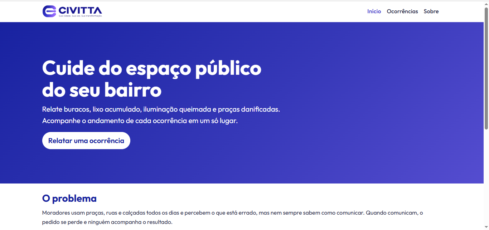
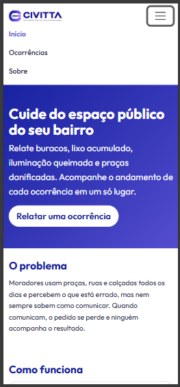
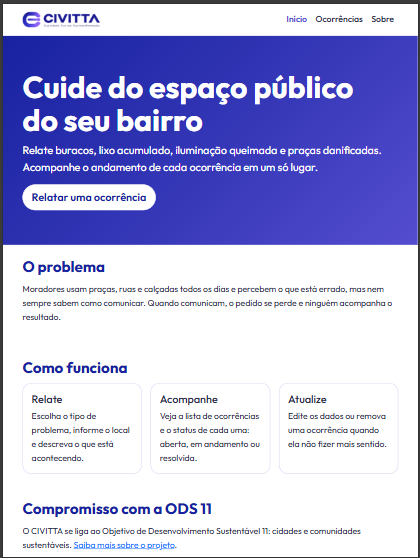
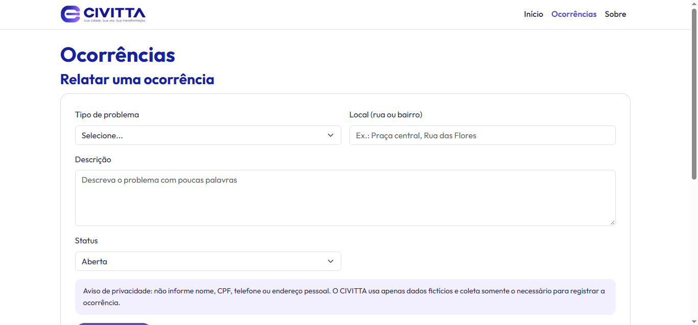
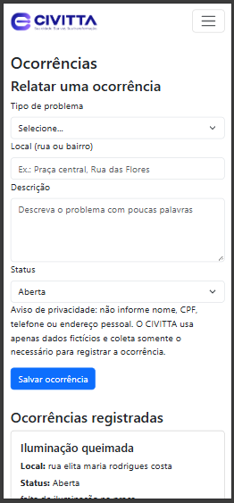
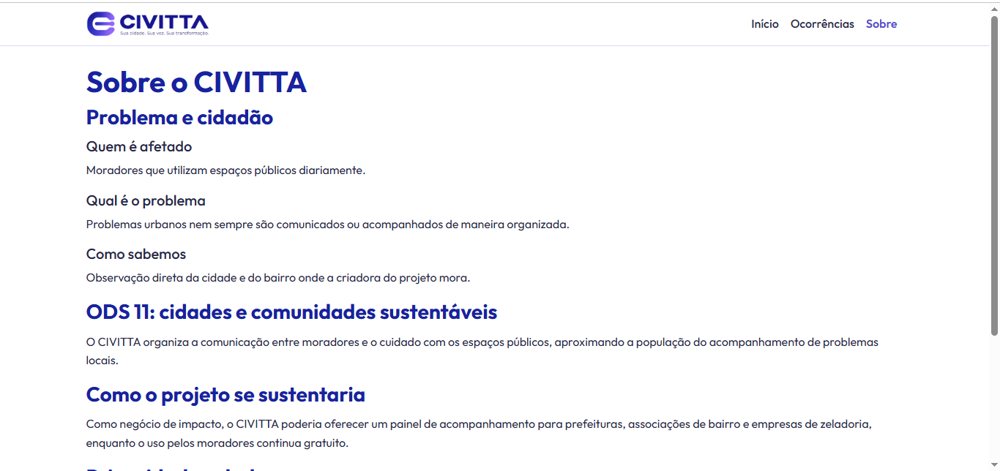

# CIVITTA

> Sua cidade. Sua voz. Sua transformação.

Protótipo funcional de uma solução de **Tecnologia Cidadã** para a avaliação P2 de Desenvolvimento Web I.

**Repositório:** https://github.com/marivwz/civitta---P2

---

## Objetivo da solução

O CIVITTA é uma plataforma de **zeladoria colaborativa**: permite que moradores relatem problemas em espaços públicos (buracos, iluminação queimada, lixo acumulado, praças danificadas) e acompanhem o andamento de cada ocorrência em um só lugar.

- **Tema escolhido:** Serviços públicos e participação cidadã
- **ODS relacionada:** ODS 11, Cidades e comunidades sustentáveis

## Problema e cidadão

- **Quem é o cidadão afetado?** Moradores que utilizam espaços públicos diariamente.
- **Qual é o problema?** Problemas urbanos nem sempre são comunicados ou acompanhados de maneira organizada.
- **Que evidência o comprova?** Observação da cidade e do bairro onde a desenvolvedora mora.

## Funcionalidades

- Formulário para relatar uma ocorrência, com validação nativa do HTML5 e validação em JavaScript, com mensagens na tela.
- **CRUD completo em JavaScript**, atualizando a página pelo DOM: adicionar, listar, editar e remover ocorrências.
- **Painel de registro de atividades** com data/hora, ação e resultado de cada operação.
- Dados guardados no `localStorage`, então permanecem ao recarregar a página.
- Layout responsivo (Mobile First), testado em três larguras.
- Aviso de privacidade no formulário e coleta mínima de dados (LGPD).

## Tecnologias usadas

- HTML5 semântico (`header`, `nav`, `main`, `section`, `article`, `aside`, `footer`)
- CSS3 com Flexbox, Grid, variáveis CSS e media queries
- Bootstrap 5.3 (navbar, cards, grid e formulário)
- JavaScript (ES6+), sem frameworks
- Git e GitHub
- Fonte Outfit (Google Fonts)

## Como executar

1. Baixe o projeto (`.zip`) ou clone o repositório:
   ```bash
   git clone https://github.com/marivwz/civitta---P2.git
   ```
2. Abra a pasta do projeto no **VS Code**.
3. Instale a extensão **Live Server**, se ainda não tiver.
4. Clique com o botão direito em `index.html` e escolha **Open with Live Server**.

> É necessário ter internet, porque o Bootstrap e a fonte são carregados por CDN.

## Estrutura de pastas

```
civitta/
├── index.html          Página inicial: apresentação e como funciona
├── ocorrencias.html    Formulário, lista de ocorrências e painel de atividades
├── sobre.html          Problema, ODS 11, modelo de impacto e privacidade
├── js/
|└── app.js              Toda a lógica (log, validação, CRUD e eventos)
├── estilos/
│   └── style.css       Estilos (Mobile First)
├── img/
│   ├── Logo.png        Logo do CIVITTA
│   └── prints/         Prints das telas usados neste README
└── README.md
```

## Modelo de dados

Cada ocorrência guarda apenas os campos abaixo:

| Campo          | Tipo   | Descrição                                           |
| -------------- | ------ | --------------------------------------------------- |
| `id`           | texto  | Identificador único gerado automaticamente          |
| `tipo`         | texto  | buraco, iluminacao, lixo, praca ou outro            |
| `local`        | texto  | Rua ou bairro (3 a 80 caracteres)                   |
| `descricao`    | texto  | Descrição do problema (10 a 300 caracteres)         |
| `status`       | texto  | aberta, andamento ou resolvida                      |
| `dataRegistro` | data   | Data e hora do registro, em formato ISO             |

## Segurança e privacidade

- **Validação de toda entrada:** campo vazio, tamanho, formato e tipo são conferidos antes de usar o dado.
- **Proteção contra injeção de HTML (XSS):** os símbolos `<` e `>` são bloqueados e o conteúdo entra na tela com `textContent`, nunca com `innerHTML`.
- **Dados guardados são revalidados** ao carregar; itens adulterados ou inválidos são descartados.
- **Mensagens de erro sem detalhes internos:** o usuário vê "Não foi possível carregar os dados. Tente novamente."; o detalhe técnico fica só no console.
- **LGPD:** coleta mínima (sem nome, CPF, telefone ou endereço pessoal), uso apenas de dados fictícios e aviso de privacidade no formulário.

## Prints das telas

| Tela | Print |
| ---- | ----- |
| Página inicial (desktop) |  |
| Página inicial (celular) |  |
| Página inicial (tablet) |  |
| Ocorrências (desktop) |  |
| Ocorrências (celular) |  |
| Página Sobre |  |

## Testes realizados

- **Larguras de tela:** celular (375px), tablet (768px) e desktop (1280px), pelo DevTools do navegador.
- **Entradas inválidas:** formulário vazio, local com poucos caracteres, descrição acima de 300 caracteres e texto com `<script>`.
- **Operações:** adicionar, editar, remover e recarregar a página.

## Limitações

- Os dados ficam apenas no navegador de quem usa (`localStorage`); não há servidor nem banco de dados.
- Não há login nem envio real das ocorrências a um órgão público.
- Todos os dados são fictícios e o projeto é um protótipo acadêmico.

Bibliotecas de terceiros: [Bootstrap 5.3](https://getbootstrap.com/) e a fonte [Outfit](https://fonts.google.com/specimen/Outfit), ambas carregadas por CDN.
